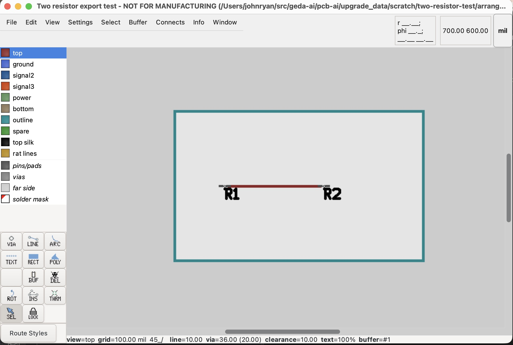

# pcb-ai

An Apple Silicon modernization effort for the original **gEDA PCB** board-layout
editor, maintained by **John Ryan, Aquana Press (Aqnana.net)**.

Companion schematic project: [gEDA-ai](https://github.com/tambotitree/geda-ai).
Upstream PCB: [gEDA PCB developers](https://github.com/gEDA-pcb-developers/pcb).

## Why this project exists

A schematic is only the beginning. We want an engineer to draw a circuit in
gEDA-ai, place its components on a board, route the copper, and print artwork
that can actually be transferred to copper-clad material and etched.

Our first acceptance test is deliberately small:

1. Draw two resistors and connect them in gschem.
2. Convert the schematic using gsch2pcb with physically verified footprints.
3. Open the board, place the components, and route one copper layer.
4. Export a PDF at **exactly 1:1 scale**, with deliberate layer, mirroring and
   polarity settings for laser-printer toner transfer.
5. Check a known dimension on paper and pad spacing against the real parts.

Copper artwork must exclude silkscreen and other unwanted annotations. The
conversion-only TEST_RESISTOR fixture in gEDA-ai is not a manufacturing footprint.
Gerber/drill and milling workflows can follow once this path is verified.

## Current status

**The GTK3 editor now compiles, links, and displays our two-resistor test board
on Apple Silicon macOS.** This is an early development checkpoint, not a
manufacturing-qualified release.
Apple Silicon macOS is the initial target. Other platforms are not verified.

- The upstream Git history is preserved, starting from revision
  `a38ac3e999f388219adadecee0add6b56eb36c6e`.
- The untouched upstream `autogen.sh` was tried. `autopoint` completed, but
  bootstrap stopped because `intltoolize` was not installed. The adapted
  English-only `bootstrap.sh` now completes; an isolated batch/PostScript
  configuration and metadata generation also pass. The batch/PostScript
  executable builds and reports the expected version.
- A two-resistor smoke test passes batch load/save/reopen, connection checking
  (including a disconnected negative control), and PostScript/PDF export.
  It uses test footprints; physical manufacture and printer scale are unverified.
- The GTK3/Cairo GUI builds with debugging symbols (`-g3 -O0`); its GTK archive
  passes `-Wall -Wextra -Werror -Wpedantic`. Menus, layer controls, embedded XPM
  tool icons and the test board are visible. OpenGL is disabled.
- Startup sizing, interaction, save/reopen and rendering behavior still need
  further testing. No supported binary installer is provided yet.
- Upstream already contains PostScript/EPS, Gerber, and experimental G-code
  export backends. Those facilities will be verified rather than assumed to
  produce correct manufacturing output on the target platform.

The existing [README](README), [README.git](README.git) and [INSTALL](INSTALL)
describe upstream PCB; their dependency and installation instructions are
historical and do not establish a working pcb-ai installation.

## GTK3 editor in action



The first GUI milestone on Apple Silicon: layer controls, embedded tool icons,
and a two-resistor board with a routed copper connection. The fixture is
**not for manufacturing**; this screenshot demonstrates the editor rendering,
not a verified production board.

## AI Assist

Open **Window → AI Assist…** to discuss the current board, including unsaved
edits. **Plan** sends the question and develops a proposal without changing the
board. Continue discussing until its scope is right; **Act** opens a review
window and **Implement** applies the reviewed proposal. Missing details leave
Act disabled. The dialog and transport are adapted from gEDA-ai: choose Ollama, OpenAI,
DeepSeek, OpenRouter, or a compatible endpoint, then load or enter a model.
Enter a key in the masked field or select a credentials `.env`. Otherwise keys
are discovered in the process environment, launch-directory `.env`,
`$GEDADATADIR/.env` (also `$GEDADATA/.env`), the configured PCB data directory,
and `$HOME/.env`, in that order. An explicitly selected file precedes automatic
file discovery; files without the selected provider's key are skipped. Python 3
is used for the HTTP helper; it requires only the standard library.

Each Send includes a fresh native PCB snapshot, omitting vector font glyph
geometry to save context space. Labels and board design data remain included;
normal saved PCB files retain their fonts.

- **Send image with next message** attaches a fresh PNG of the current visible
  viewport and layers. Use a model that supports images.
- **Allow automatic image request** lets the model ask for one PNG continuation
  per turn. Disable it for text-only models. No old image is reused after edits.
- Select pads (or an element containing pads) before asking to resize their
  **width**. A supported proposal enables **Act**. The
  editor checks the original board/selection, pad locks and width limits,
  groups the changes into one undo step, then redraws the board and PNG preview.
  Endpoints remain fixed; solder-mask width follows the editor's normal resize
  behavior. This does not scale pad length/area.
- Select plated vias and request an increase in **outer copper diameter**, with
  an explicit amount (for example, 20% larger). Implement enlarges the via rings,
  retaining drill holes, positions and layer spans. It does not create separate
  surface pads or convert unplated holes.

Selection, proposal validation, dispatch, undo and redraw are shared across
registered operations. Selected traces include layer/endpoints/clearance in the
context, and components include references and bounds. The model uses these
identities rather than inferring selection from pixels. If a requested reference
or circuit cannot be found, it should ask whether to create it and request
placement plus a part ID or pinout/footprint. Native routing and component-creation operations are not exposed yet; other
geometry edits can be proposed as reviewed PCB patches.

The assistant cannot run arbitrary actions or replace the board file. Run DRC
and inspect any changes before manufacture; this is not automatic clearance or
connectivity certification. Keys are not saved in the provider preferences.

Offline protocol checks: `python3 tools/test_ai_chat_backend.py` and
`python3 tools/test_ai_visual_protocol.py`. The macOS native test runner
`tools/test_ai_visual_native.py --board PATH` uses a disposable copy of a
board containing two two-pad elements and a loopback-only mock provider.

## Modernization approach

Work proceeds in consultation with the maintainer, one reviewable step at a time:

- Establish the baseline failure before changing the code.
- Review applicable mechanical migration tools before fixing individual errors.
- Adapt gEDA-ai's bootstrap approach to PCB's own build system and m4 macros.
- Start with an English-only build, preserving translation sources for later.
- Target GTK3 and the existing modern Homebrew toolchain. Use Guile 3 and
  Python 3 where dependencies actually require them; do not add unused runtimes.
- Preserve explicit callback types and enable strict compiler diagnostics.
- Bundle icons instead of relying on a desktop theme installation.
- Keep debugging symbols and test open/edit/save/reopen and physical export scale.

Track stage completion, decisions and test notes in the
[upgrade tracker](UPDATE_PROJECT_TODO.md). The
[GUI refactor list](GUI_REFACTOR_TODO.md) applies lessons from gschem. See [the project plan](PCB_AI_PLAN.md)
for the original scope and acceptance criteria.
A successful compiler run alone will not count as a working board-production tool.

## Getting the source

```sh
git clone https://github.com/tambotitree/pcb-ai.git
cd pcb-ai
git remote add upstream https://github.com/gEDA-pcb-developers/pcb.git
```

Generate the English-only build system with `./bootstrap.sh` (the historical
`./autogen.sh` delegates to it). It requires Autoconf 2.73, Automake and their
normal macro dependencies, but does not run autopoint or intltoolize. Translation
catalogs remain in `po/`. Configure requires GNU Bison 3.0 or newer.
On macOS, `m4/pcb-macos.m4` prefers Homebrew's keg-only Bison, obtained with
`brew install bison`, without changing your shell PATH. An explicit `YACC`
override is honored but must pass the version check. Native-language support is deferred; `--enable-nls`
is rejected and `--disable-nls` is accepted.

The GTK3 configuration used for this checkpoint is:

```sh
./bootstrap.sh
mkdir -p upgrade_data/scratch/build-gtk3
cd upgrade_data/scratch/build-gtk3
../../../configure --with-gui=gtk --with-exporters=ps \
  --disable-doc --disable-nls --disable-gl --disable-dbus \
  --disable-update-mime-database --disable-update-desktop-database \
  --enable-debug --prefix=/tmp/pcb-ai-gtk3-test \
  CFLAGS='-g3 -O0' CXXFLAGS='-g3 -O0'
make -j1
```

This requires the modern Homebrew GTK3/Cairo development dependencies. It is a
source-build checkpoint; no supported binary package is provided yet.

## Reviewing AI design patches

The assistant returns a `<pcb-ai-proposal>` section containing JSON with a
summary and numbered replacements (or a legacy exact unified diff) for
`current.pcb`, the live board snapshot including unsaved edits. The host generates the diff from the frozen source, preserving original context
and spacing. It checks the SHA-256 base hash and every context line, then parses a private staged PCB.
An invalid proposal gets at most one automatic model correction request. If it
still fails, the dialog reports the validation reason; no edit is applied.
**Act** opens the proposed diff, parser result, and before/after viewport tabs.
**Back to planning** leaves the board untouched; **Implement** rechecks the frozen
board and selection before updating it. One native Undo/Redo restores/reapplies
the complete board. Runtime layer/object visibility is preserved. Layer-count
changes are currently unsupported by patch application. Save the board normally afterward; no source design file is
silently overwritten.

The parser check is not electrical or manufacturing validation. Run DRC and
inspect the proposed geometry, connectivity and layer changes. A 3 mm pad can
short nearby pads on the small two-resistor fixture. Native resize proposals
show their target selection and constraints; their geometry is rechecked at
Implement. Only patch proposals currently provide an after-preview tab.

The editor currently supplies **only the open PCB**. A paired `.sch` document is
not inferred or edited. Explicit schematic attachment, native schematic
validation and coordinated cross-editor undo remain follow-up work.

Offline checks:

```sh
PYTHONDONTWRITEBYTECODE=1 python3 tools/test_ai_design_patch.py
PYTHONDONTWRITEBYTECODE=1 python3 tools/test_ai_visual_protocol.py
PYTHONDONTWRITEBYTECODE=1 python3 tools/test_ai_chat_backend.py
G_DEBUG=fatal-criticals python3 tools/test_ai_visual_native.py \
  --board upgrade_data/scratch/two-resistor-test/arranged.pcb
```

The last test uses a disposable board, private GTK process and loopback mock
provider; it makes no real model requests.

## Release identity

The authoritative version is the literal `AC_INIT` version in `configure.ac`.
The current development checkpoint is `0.1.4-20261026`. The GTK3 executable
builds and displays the two-resistor board. Batch/PostScript smoke tests pass;
physical manufacturing and full GUI operation remain unverified.
Versions follow `MAJOR.MINOR.PATCH-YYYYMMDD`, matching gEDA-ai's release format.

```sh
python3 tools/version.py show
python3 tools/version.py set 0.1.4-20261026  # example next version
python3 tools/version.py check
```

After changing the version, regenerate the build system and rebuild. Autoconf
and Automake use it for `VERSION`, `PACKAGE_VERSION` and `make dist` archive names.
The source version remains available in tarballs without Git or Python at build time.
The Python helper is a maintainer tool.

Development checkpoints may be tagged before the build works. The initial
`0.1.0-20261020` tag records the version tooling; its build and release tarball
are unverified. A tag does not establish a tested release.

For a tested release, pass the build and acceptance tests, commit the sources,
and create an annotated tag with the exact version printed by the helper
(no `v` prefix). After `make dist`, validate both identities before publishing:

```sh
python3 tools/version.py check --tag --archive pcb-ai-0.1.4-20261026.tar.gz
```

`--tag` requires a clean checkout and the matching annotated tag at HEAD.
`--archive` checks the filename, top directory and embedded source version.
The helper never creates tags or pushes. Archive checks do not replace build,
installation or physical print-scale tests. Run its regression tests with
`python3 tools/test_version.py`.

## Support and contributions

- [Issues and development discussion](https://github.com/tambotitree/pcb-ai/issues)
- [Pull requests](https://github.com/tambotitree/pcb-ai/pulls)

Current maintenance belongs to John Ryan / Aquana Press. Please use this
project's tracker for pcb-ai support rather than contacting historical authors.

## License and credits

This project preserves the original PCB authors' history, copyrights and
licenses. PCB is GNU GPL software; see [COPYING](COPYING) and individual source
headers for applicable terms. The upstream [README](README) retains the original
project information. The pcb-ai name does not imply endorsement by the upstream
maintainers or the GNU Project.

## Startup window size

PCB-ai defaults to two-thirds of the usable monitor width and height, with a
1280x720 minimum where the display permits. Tiny saved preferences are raised;
larger saved sizes are retained and clamped to the monitor work area. This also
applies when starting with an empty board. Sizes use GTK logical pixels.

The isolated empty-board startup check is:

```sh
G_DEBUG=fatal-criticals python3 tools/test_ai_visual_native.py --startup-only
```

It uses temporary settings and does not contact an AI provider.
